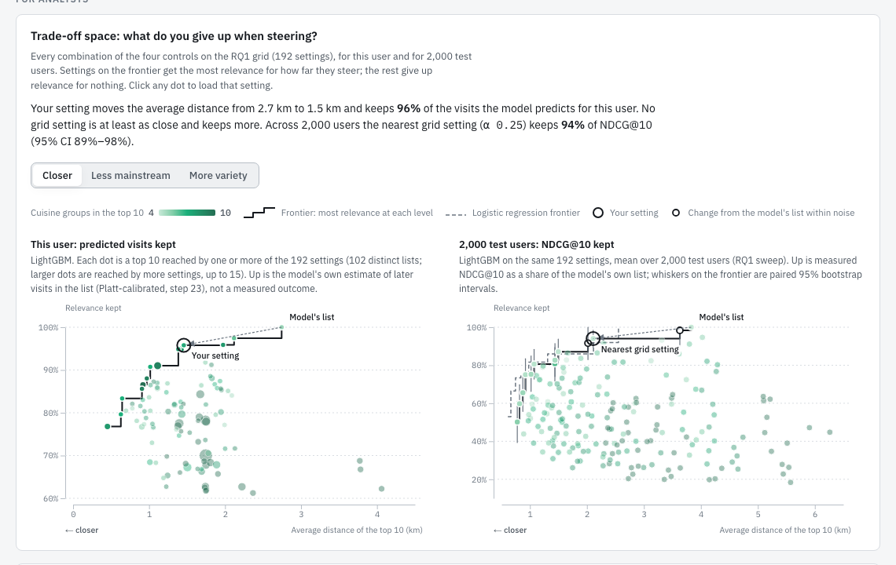
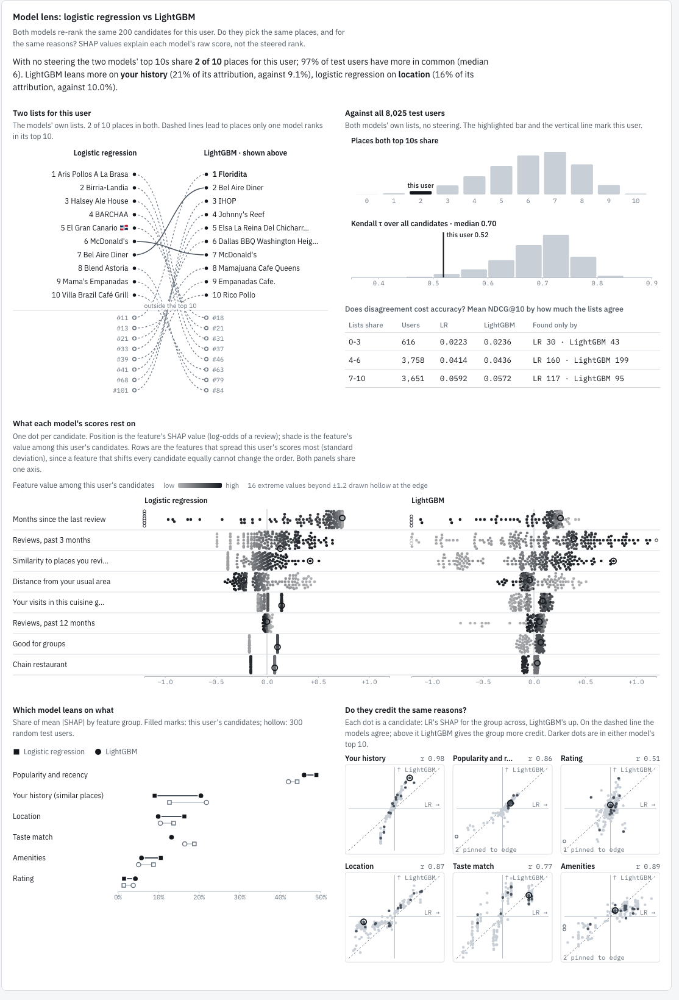
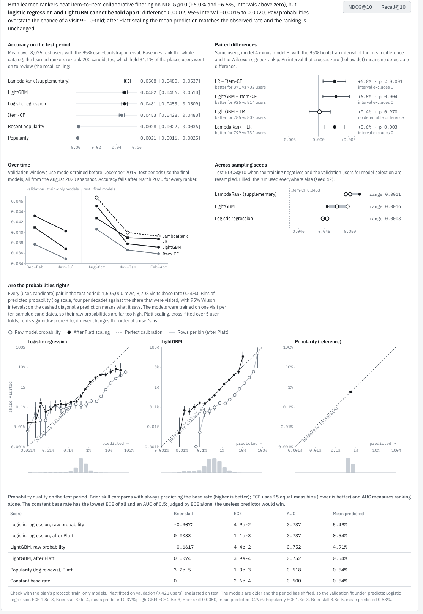

# web

SteerEats interface (Vite + D3 v7). All steering runs in the browser from the case files in
`public/data/cases/`; `src/steer.js` mirrors `src/steering.py` exactly (see `tests/replay.mjs`).

```bash
cd web
npm install
npm run dev        # http://localhost:5173
npm run build      # static site in web/dist
```

Deep links: `#case=demo_03&model=lr&wh=0.5&km=2&pop=0.4&cui=6&sel=12&boost=11` (case, model, history weight, max average km,
max popularity percentile, min cuisine groups, selected candidate, boosted neighborhood index).

| File | Role |
|---|---|
| `src/main.js` | state, loading, solving targets per model, linking views |
| `src/steer.js` | steering math, change accounting (fixed order and Shapley), outcome-target solver |
| `src/views/console.js` | V1 steering console with outcome targets |
| `src/views/preview.js`, `src/preview.js` | previews under each control: predicted visits kept across the control's range, targets re-solved at every value; hover to read, click to set |
| `src/views/flow.js` | V2 rank flow (bump chart across steering steps) |
| `src/views/map.js` | V4 map: neighborhoods shaded by steering cost, click-to-boost, usual area, distance rings, new and departed places |
| `src/views/list.js` | top 10 with Shapley attribution of each rank change |
| `src/views/ledger.js` | V3 score ledger (SHAP groups + steering on one normalized scale) and "why A over B" contrast |
| `src/views/tradeoff.js`, `src/tradeoff.js` | V5 trade-off space: the 192 grid settings for this user (predicted visits kept) and for 2,000 test users (NDCG@10 kept, paired 95% intervals), Pareto staircases, linked hover, click a dot to load its setting |
| `src/views/lens.js`, `src/lens.js` | V6 model lens: both top 10s as a slope chart, the user against all 8,025 test users, side-by-side SHAP beeswarms, SHAP reliance by group, per-group attribution agreement |
| `src/views/evaluation.js` | V7 evaluation: Recall@10 / NDCG@10 with 95% bootstrap intervals, paired differences, periods, sampling seeds, reliability diagrams before and after Platt scaling |
| `public/data/` | demo cases, simplified NTA and borough boundaries, NTA code index |








Checks: `node tests/replay.mjs` (browser equals Python) `node tests/check_ledger.mjs` (ledger bars are exact SHAP values that sum to the steered score) `node tests/check_lens.mjs` (model-lens statistics equal `src/22_model_lens.py`) `node tests/check_tradeoff.mjs` (trade-off points and frontiers equal `src/25_export_tradeoff.py` and `src/21_rq1_frontier.py`) and `node tests/check_preview.mjs` (console previews equal `src/steering.py`).
