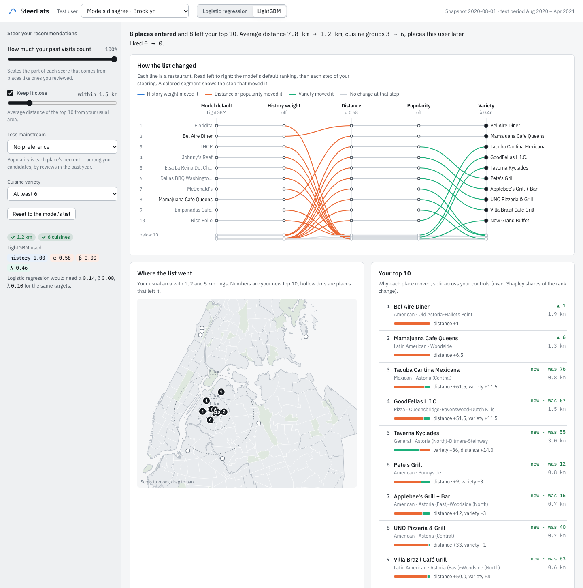
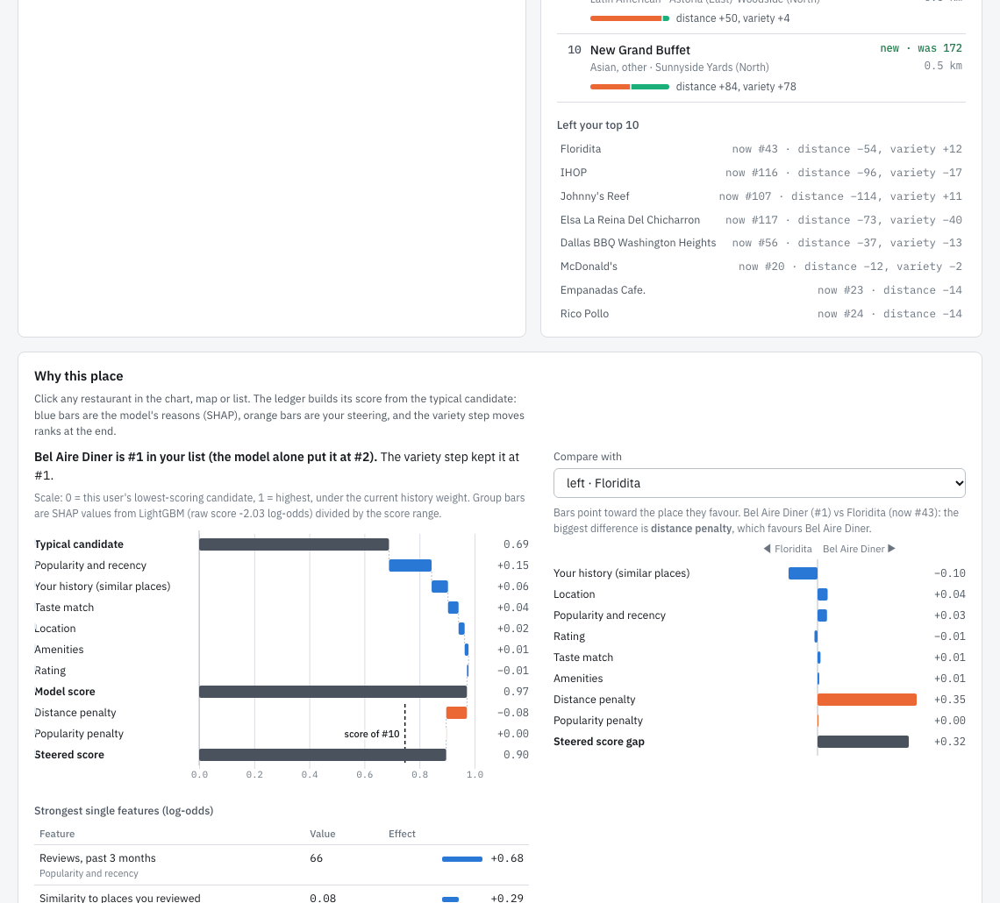

# web

SteerEats interface (Vite + D3 v7). All steering runs in the browser from the case files in
`public/data/cases/`; `src/steer.js` mirrors `src/steering.py` exactly (see `tests/replay.mjs`).

```bash
cd web
npm install
npm run dev        # http://localhost:5173
npm run build      # static site in web/dist
```

Deep links: `#case=demo_03&model=lr&wh=0.5&km=2&pop=0.4&cui=6&sel=12&boost=11` (case, model, history weight, max average km,
max popularity percentile, min cuisine groups, selected candidate, boosted neighborhood index).

| File | Role |
|---|---|
| `src/main.js` | state, loading, solving targets per model, linking views |
| `src/steer.js` | steering math, change accounting (fixed order and Shapley), outcome-target solver |
| `src/views/console.js` | V1 steering console with outcome targets |
| `src/views/flow.js` | V2 rank flow (bump chart across steering steps) |
| `src/views/map.js` | V4 map: neighborhoods shaded by steering cost, click-to-boost, usual area, distance rings, new and departed places |
| `src/views/list.js` | top 10 with Shapley attribution of each rank change |
| `src/views/ledger.js` | V3 score ledger (SHAP groups + steering on one normalized scale) and "why A over B" contrast |
| `public/data/` | demo cases, simplified NTA and borough boundaries, NTA code index |





Checks: `node tests/replay.mjs` (browser equals Python) and `node tests/check_ledger.mjs` (ledger bars are exact SHAP values that sum to the steered score).
